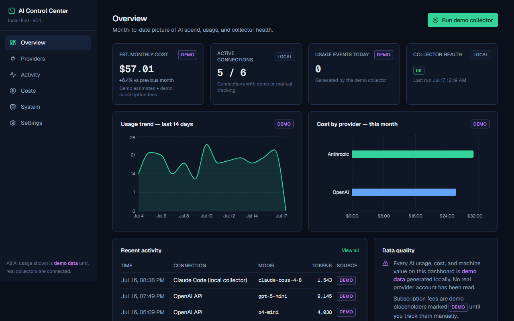
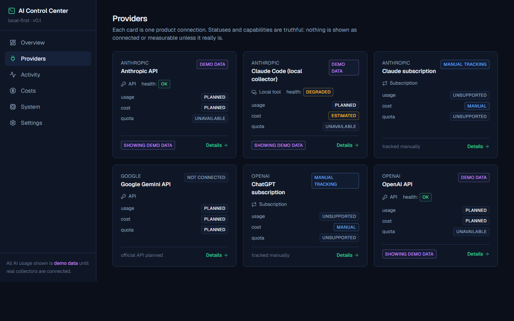
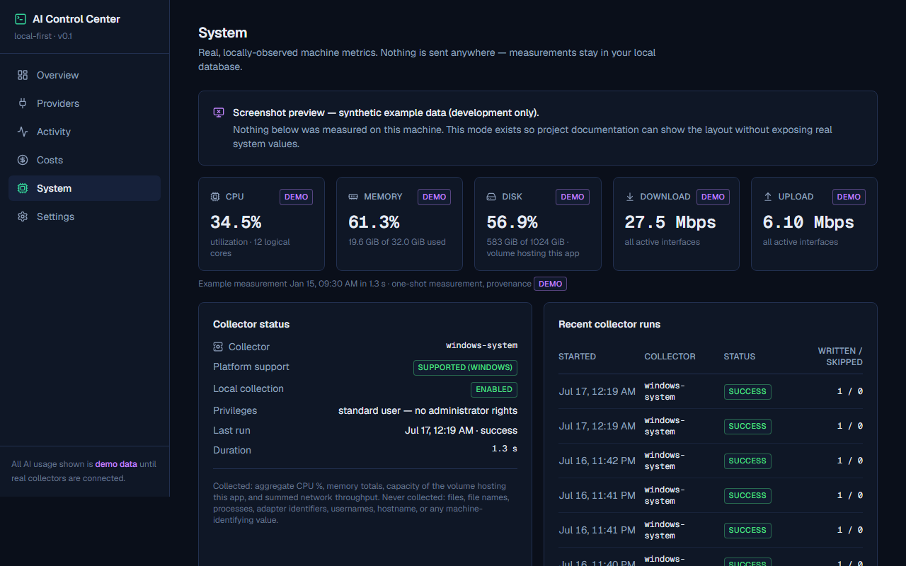

# AI Control Center

**A local-first, open-source control center for monitoring your AI subscriptions, API usage, costs, and coding-agent activity — with truthful data provenance and zero telemetry.**

[](https://github.com/yashar0134/ai-control-center/actions/workflows/ci.yml)
[](LICENSE)

> **Early-stage notice (pre-1.0):** this is a local-first, pre-production foundation. Two things are real today: the collector architecture (end-to-end) and **on-demand Windows system metrics** (`locally-observed`). **All AI usage and cost metrics are still clearly-labeled demo data** — no real AI provider integration is connected yet.

## What it does today

- **Overview dashboard** — month-to-date cost, change vs. previous month, active connections, usage events, collector health, cost-by-provider and usage-trend charts
- **Providers** — six product connections (ChatGPT subscription, Claude subscription, Claude Code, OpenAI API, Anthropic API, Gemini API) shown in *truthful* states: demo data, manual tracking, or not connected
- **Connection details** — capabilities, provenance, recent usage and costs, collector status, and privacy notes per connection, fully database-driven
- **Activity** — normalized usage events with URL-based filters (connection, model, status, provenance)
- **Costs** — monthly totals split by actual / estimated / manual, provider breakdown, 30-day trend, records table
- **System** — **real Windows machine metrics on demand**: click "Collect now" for a one-shot measurement of CPU utilization, memory, disk capacity, and network throughput, labeled `locally-observed` with capture time and stale marking (older than 2 minutes). Windows only; other platforms see a truthful unsupported state. No administrator rights needed. Demo snapshots remain available in a separately labeled section
- **Settings** — display currency, week start, collection toggle, retention, anonymized-metadata preference, dark/light theme — persisted locally in SQLite
- **Demo collector** — a working end-to-end vertical slice: collect → validate → de-duplicate → persist → audit → UI, idempotent by design

## Screenshots







> The System screenshot uses the built-in **screenshot-preview mode** (synthetic fixture values, every tile labeled "demo") so no contributor's real machine statistics appear in the repository. On a real Windows machine the tiles show your actual values labeled `locally observed`. Capture guidelines: [docs/screenshots/README.md](docs/screenshots/README.md).

## Core principles

1. **Truth over appearance** — every value carries a provenance label (`demo`, `manual`, `estimated`, `live`, …); unknown values display as "unknown", never as 0; nothing is fabricated.
2. **Local-first** — runs entirely on your machine; one SQLite file holds all data and deleting it removes everything.
3. **Privacy by default** — no telemetry, no external API calls, no secrets stored, and never any prompts, completions, source code, or file names — safe metadata only.
4. **Official interfaces only** — no scraping, no cookie/session tricks, ever.

## Data sources: implemented vs. planned

| Source | Status |
| --- | --- |
| Demo collector (deterministic, labeled) | ✅ implemented |
| Local Windows system metrics (CPU, memory, disk, network) | ✅ implemented — manual "Collect now", Windows only |
| Manual subscription cost tracking | 🟡 schema ready, demo placeholders seeded |
| Claude Code local metadata (tokens/models only) | 🔜 planned (Phase 3) |
| OpenAI / Anthropic official usage & cost APIs | 🔜 planned (Phase 5) |
| Gemini API via Google Cloud | 🔜 planned |
| ChatGPT / Claude **subscription usage & quotas** | ❌ **not possible** — no official API exists, and this project will never scrape accounts |

Full truthful matrix: [docs/DATA-SOURCES.md](docs/DATA-SOURCES.md).

### What the Windows system collector reads — and never reads

Collected (aggregate totals only): CPU utilization % and logical core count, memory used/free/total bytes, capacity of the volume hosting the app, and summed network throughput across active interfaces. Collection is **manual** (one measurement per click — no background monitoring), needs **no administrator rights**, and nothing leaves your machine.

Never collected: files, file names, directory listings, processes, window titles, adapter names, MAC/IP addresses, Wi-Fi names, usernames, hostname, serial numbers, or any machine-identifying value. Raw command output is validated and discarded — never stored.

## Current limitations

- All displayed **AI usage and cost** metrics are **demo data**, generated locally and labeled as such. System metrics are real only on Windows after you click "Collect now".
- **No official ChatGPT or Claude subscription quota API is integrated** — none exists. Those capabilities are permanently marked `unsupported`; subscription fees are tracked manually.
- Single display currency, no live conversion.
- Single-user, local machine only. Do not expose the server to untrusted networks.

## Tech stack

Next.js (App Router) · React · TypeScript (strict) · Tailwind CSS · Prisma 6 + SQLite · Zod · Recharts · Lucide · Vitest

## Prerequisites

- [Node.js](https://nodejs.org) **20 or newer** (check with `node --version`)
- Git

Works on Windows, macOS, and Linux. All commands below are identical on every platform.

## Quick start

Open a terminal (on Windows: right-click inside a folder → "Open in Terminal") and run each command on its own:

```
git clone https://github.com/yashar0134/ai-control-center.git
```

```
cd ai-control-center
```

```
npm install
```

Expected: ends with `added ... packages` (warnings are OK).

```
npx prisma migrate dev
```

Expected: `Your database is now in sync with your schema`, then a seed message. This creates the local database `prisma/dev.db` and fills it with labeled demo data.

```
npm run dev
```

Then open **http://localhost:3000** in your browser. Stop with `Ctrl + C`.

## Database commands

| Command | What it does |
| --- | --- |
| `npx prisma migrate dev` | Applies migrations to your local SQLite database (creates it if missing) and seeds it |
| `npm run db:seed` | Re-runs the deterministic demo seed (idempotent — safe anytime) |
| `npm run db:generate` | Regenerates the Prisma client after schema changes |

Fresh start: delete `prisma/dev.db`, then run `npx prisma migrate dev` again.

## Validation commands

```
npm run validate
```

Runs lint → type-check → unit tests → production build. Individual commands: `npm run lint`, `npm run typecheck`, `npm test`, `npm run build`.

## Project structure

```
prisma/            database schema, migrations, demo seed
src/app/           routes (Server Components)
src/components/    presentational components (shell, ui, charts, forms)
src/lib/           formatting helpers
src/server/
  domain/          core types: provenance, capabilities, cost aggregation
  collectors/      collector contracts, demo collector, dedupe, normalize
  providers/       typed registry of provider/connection metadata
  db/              Prisma client
  services/        application services (collector runs, analytics, settings)
  actions/         Next.js server actions
tests/             Vitest unit tests
docs/              architecture, data sources, roadmap, decisions
```

Architecture details: [docs/ARCHITECTURE.md](docs/ARCHITECTURE.md).

## Privacy and security

- No external network calls, no telemetry, no accounts, no cloud.
- No API keys or credentials are requested or stored in this version.
- Only safe metadata is ever modeled (timestamps, model names, token counts, aggregate costs) — never content payloads.
- Found a vulnerability? Please report it privately — see [SECURITY.md](SECURITY.md).

## Roadmap

Phase 2 (real local system collector) → Phase 3 (Claude Code local metadata) → Phase 5 (official API usage/billing adapters) → more. Full plan with entry/exit criteria: [docs/ROADMAP.md](docs/ROADMAP.md).

## Contributing

Contributions are welcome — please read [CONTRIBUTING.md](CONTRIBUTING.md) and the project constitution [PROJECT_RULES.md](PROJECT_RULES.md) first. Open an issue before large changes.

## License

[Apache-2.0](LICENSE) © 2026 Yashar Ahmadabadi

## Support

Questions, bugs, and proposals: see [SUPPORT.md](SUPPORT.md). This is an early-stage community project with no guaranteed SLA.

## Troubleshooting

| Problem | Fix |
| --- | --- |
| `npm` is not recognized | Install Node.js from nodejs.org, then reopen the terminal |
| `EPERM` / file-in-use errors on Windows | Close any running `npm run dev` terminal and try again |
| "Something went wrong" page in the browser | The database may be missing — run `npx prisma migrate dev` |
| Port 3000 already in use | Run `npm run dev -- -p 3001` and open http://localhost:3001 |
| System page shows "Unavailable" for network | The one-shot probe could not read throughput counters (e.g. PowerShell unavailable or timed out). CPU/memory/disk still work; try collecting again |
| System page shows "unsupported" | Real system collection currently works on Windows only |
| Want a fresh start | Delete `prisma/dev.db`, then run `npx prisma migrate dev` again |
